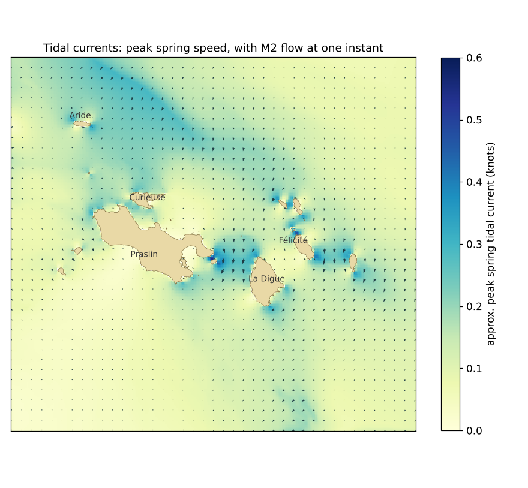
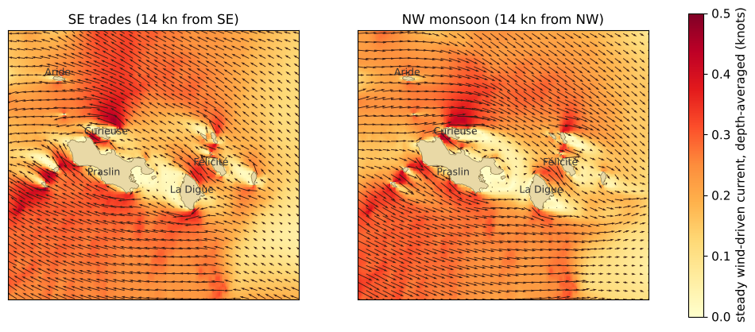

Anyone who dives or paddles around Praslin learns to ask the same question before getting in: *which way is the water going, and how hard?* The answer usually comes from local knowledge, a glance at the tide table, and whoever went out yesterday. I wanted something better: a model that could give the direction and strength of the current at any point around Praslin and Curieuse, at any time.

So I built one. You can use it here:

  <iframe src="{{ '/assets/currents/praslin/' | relative_url }}" title="Praslin and Curieuse current model" loading="lazy" style="width:100%;height:min(92vh,980px);border:1px solid rgba(128,128,128,.35);border-radius:8px"></iframe>
  
<a href="{{ '/assets/currents/praslin/' | relative_url }}">Open the current map full screen →</a>

Tap anywhere on the chart to get the speed and direction there, split into its tidal and wind-driven parts, with a 24-hour curve showing when the flow is weakest and strongest. There's a depth-averaged layer for divers and a surface layer for boats and kayaks. Wind can be left at the seasonal norm, or you can type in a forecast. You can also save your own spots as pins.

The rest of this post covers how it works, what it found, and how far to trust it. The short version: **treat the pattern and timing as useful, and treat the speeds as plausible to within about a factor of two.** No measured currents have gone into it yet.

## Why tide tables aren't enough

The obvious approach is to read the tide table: water flows in on the flood and out on the ebb. That logic is borrowed from places like the English Channel, where a large tidal range is squeezed through narrow, shallow seas. Praslin sits on the Seychelles Plateau, a broad shallow bank about 40–60 m deep, surrounded by ocean thousands of metres deep. The tide here is mixed and mostly semidiurnal, with a spring range of a little over a metre.

Mooring studies on the plateau have found that the tide is *not* the main source of current variability. Much of it comes from near-inertial oscillations: when the wind changes, the water keeps swinging round with a period of $2\pi/f$. Here $f = 2\Omega\sin\phi$ is the Coriolis parameter, $\Omega$ is the Earth's rotation rate and $\phi$ is the latitude. At 4.3°S that period is about 6.6 days. On top of that sit the monsoon-driven flows, which reverse between the NW monsoon (roughly December to March) and the SE trades (roughly May to October).

So a useful model needs both a tidal part and a wind-driven part.

## Building it

The ingredients are all freely available:

- **Bathymetry** from the GEBCO 2026 global grid (15 arc-second, about 460 m).
- **Coastline** from OpenStreetMap.
- **Tides** from the University of Hawaii Sea Level Center's hourly record for the Pointe La Rue gauge on Mahé. A least-squares harmonic fit to three years of data (2022–24) gives the main constituents: M2 is about 0.39 m, K1 about 0.20 m, S2 about 0.18 m and O1 about 0.12 m. The fit leaves a residual of about 9 cm, which is mostly weather.

The engine is a 2D depth-averaged shallow-water model, the textbook equations with a few terms added:

$$\frac{\partial \mathbf{u}}{\partial t} + (\mathbf{u}\cdot\nabla)\mathbf{u} + f\,\hat{\mathbf{z}}\times\mathbf{u} = -g\nabla\eta + \frac{\boldsymbol{\tau}_{\text{wind}}}{\rho D} - \frac{C_d|\mathbf{u}|\mathbf{u}}{D} + \nu\nabla^2\mathbf{u}$$

$$\frac{\partial \eta}{\partial t} + \nabla\cdot(D\mathbf{u}) = 0$$

Here $\mathbf{u}$ is the depth-averaged velocity, $\eta$ the sea-surface height and $D$ the total water depth. The right-hand side of the first equation is the surface slope, wind stress, quadratic bottom friction and eddy viscosity. It's solved on a staggered grid in two nested layers:

1. **A plateau model** covering 2.5–6.5°S and 54–57.5°E at about 1.85 km resolution, with the tide imposed at its deep-water edges. I adjusted that boundary tide until the model reproduced the Mahé gauge. The plateau turns out to amplify the semidiurnal tide by about 12% and delay it by a few degrees of phase.
2. **A Praslin model** at 150 m resolution, covering Aride to Marianne and Cousine to Félicité, driven at its edges by the plateau model.

Tidal currents come from a 32-day run. I harmonically analyse every grid cell, so each one gets an amplitude and phase for M2, S2, N2, K1 and O1; K2, P1 and Q1 are inferred from the gauge's ratios. Predicting any date then just means summing cosines, with the astronomical arguments and the 18.6-year nodal corrections worked out in the browser.

Wind-driven currents come from steady-state runs with a 7 m/s wind from each of eight compass directions. The map interpolates between them for whatever wind you enter, and scales the result with wind speed. That scaling is roughly right when bottom friction dominates.

## What it found

**The tidal currents are weak.** Over most of the area the peak spring tidal current is 0.1–0.3 knots. It only reaches about half a knot off headlands, in the gap between Praslin and La Digue, and around Félicité and the Sisters.

**Wind matters as much as tide, or more.** A steady 14-knot wind drives a depth-averaged current of about 0.15–0.4 knots, concentrated off the ends of the islands and in the channels. The flow doesn't go straight downwind. In the southern hemisphere, Coriolis deflects wind-driven flow to the *left* of the wind, so the SE trades push water broadly west-north-west past Praslin, and the NW monsoon pushes it east-south-east. Curieuse, the Curieuse channel and the north-west tip of Praslin show up as hotspots in both seasons.

**The tide prediction holds up.** As an independent check, I compared the model's high and low waters at Baie Ste Anne for late November and early December 2026 with a published Praslin tide table. They agree to within about 2–15 minutes and 0.1 m. That validates the astronomy and the calibration. It says nothing about the current *speeds*, which is the honest gap.

## What it can't do

- **It can't see the inertial wobble.** An oscillation set off by last week's change in wind isn't predictable from the tide and today's wind. Expect unexplained drift of 0.1–0.3 knots.
- **The bathymetry is poor.** GEBCO has a spurious shoal north of Praslin, which I floored at 12 m. It doesn't resolve reef edges, rocks or pinnacles, so flow squeezed around a granite headland will be faster than the model shows.
- **It leaves out waves, rips, swell-driven reef currents and vertical shear.** The depth-averaged current isn't what you feel at 25 m on a day with a strong surface drift.

So it's a guide to the shape of the flow, not a safety tool.

## How to make it better

The biggest gain would come from **observations**. A GPS track from a drifting SMB or a drogued drifter, logged with the time and the wind, is exactly what's needed to calibrate the friction and wind response. If you dive or paddle around Praslin and record your drift, I'd love to hear from you. Better depths, from chart soundings or local surveys, would be the next step up. Sooner or later I'll start logging my own.

Data: GEBCO Compilation Group (2026) GEBCO 2026 Grid; coastline © OpenStreetMap contributors (ODbL); tide gauge data from the University of Hawaii Sea Level Center, station 121 (Pointe La Rue).

